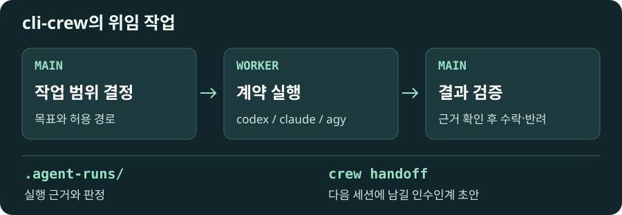

# cli-crew

[English](README.md) · **한국어**

사용자는 AI 코딩 도구에 목표를 전달합니다. **cli-crew 스킬**은 현재 대화 중인 AI가 직접 처리할 일과 다른 CLI에 맡길 일을 판단하고 결과까지 검증하는 방법을 안내합니다. **`crew` 명령**은 선택한 워커를 실행하고 작업 기록을 남깁니다.



## 프로젝트에서 처음 사용할 때

파일 수정이 허용된 작업에서는 스킬이 프로젝트 루트에서 `crew init`을 실행합니다. 루트에 `AGENTS.md`, `CLAUDE.md`, `GEMINI.md`가 하나도 없으면 기본 `AGENTS.md`를 만들고, 메인이 저장소에서 확인한 실행 명령과 작업 규칙을 보완합니다. 기존 지침은 그대로 사용합니다. 초기화만 원하면 “이 저장소를 보고 프로젝트 작업 지침을 만들어줘”라고 요청하세요.

## 사용 예시

작업할 프로젝트에서 AI에게 다음과 같이 요청합니다.

> CSV를 내보내면 마지막 행이 빠지는 원인을 찾아줘. 재현되면 수정하고 회귀 테스트까지 추가해줘.

간단한 수정은 현재 AI가 직접 처리합니다. 독립적인 리뷰가 도움이 된다면 다른 CLI에 검토할 질문과 파일을 지정해 맡길 수 있습니다. 현재 AI는 리뷰 결과를 코드와 대조하고 테스트를 실행합니다. 선호하는 워커를 지정할 수도 있고, 선택을 AI에 맡길 수도 있습니다.

## 작업을 위임하는 방식

워커마다 목표와 완료 조건을 담은 **작업 계약**을 작성합니다. 파일을 수정하는 작업에는 허용 경로도 지정합니다. 서로 독립적인 읽기 작업은 최대 3개까지 동시에 실행하고, 쓰기 작업은 한 번에 하나씩 실행합니다.

| 워커 CLI | 맡길 수 있는 작업 |
| --- | --- |
| Codex (`codex`) | 조사, 리뷰, 지정 범위의 수정 |
| Claude Code (`claude`) | 조사, 리뷰, 지정 범위의 수정 |
| Antigravity (`agy`) | 조사 및 리뷰 전용 |

위임하면 선택한 CLI의 계정이 사용되며 프로젝트 내용이 해당 제공업체에 전달될 수 있습니다. 현재 AI는 위임 전에 프로젝트 지침을 확인합니다. 실행 후 `crew`는 프로젝트 안에서 감지한 변경 사항을 보고하고 워커의 결과를 `.agent-runs/`에 저장합니다. 현재 AI가 근거를 확인하고 수락 여부를 기록합니다.

## 다른 CLI에서 작업 이어가기

세션을 마치기 전에 작업 중인 프로젝트에서 실행합니다. `codex`와 `csv-export`는 현재 메인 에이전트와 작업 이름으로 바꾸세요.

```powershell
crew handoff --agent codex --task csv-export --status "In progress" --lang ko
```

이 명령은 `handoffs/` 아래에 날짜별 Markdown 초안을 만듭니다. 기존에 `handoff/` 폴더를 사용 중이라면 그 위치를 따릅니다. 초안에는 선택된 실행 기록과 메인이 기록한 검증 내용이 들어갑니다. 남은 작업과 다음 세션에서 처음 확인할 사항을 적어 마무리하세요.

다음 CLI에서 **같은 작업 폴더**를 열고 “최신 인수인계 기록을 읽고 현재 Git 상태와 대조한 뒤 이어서 작업해줘”라고 요청하세요. 현재 제공하는 방식은 이처럼 기록을 이용한 수동 인수인계입니다. 메인 에이전트 자동 전환과 다른 CLI에서의 재개 검증은 [명세의 후속 항목 T-06](docs/SPEC.md)에 있습니다. 이 저장소는 `handoffs/`와 `.agent-runs/`를 Git에서 제외하므로 새로 복제하면 해당 로컬 기록은 따라오지 않습니다.

## Windows 설치

Git, PowerShell 7(`pwsh`), Python 3.12 이상, [uv](https://docs.astral.sh/uv/)가 필요합니다. 작업을 위임하려면 워커 CLI를 하나 이상 설치하고 로그인하세요. PowerShell에서 다음 명령을 실행합니다.

```powershell
git clone https://github.com/HBy-cloud/cli-crew.git
cd cli-crew
uv tool install ./crew
$env:Path = "$(uv tool dir --bin);$env:Path"
pwsh -File scripts/install-skill.ps1
crew --version
```

기본 설치는 세 클라이언트에 스킬을 등록합니다. 일부만 선택하려면 `pwsh -File scripts/install-skill.ps1 -Agents claude,codex`를 실행하세요. Claude Code와 Codex는 디렉터리 정션을 사용하고, agy는 `~/.gemini/config/skills.json`에 스킬 경로를 등록합니다. 설치 후에도 복제한 폴더를 같은 위치에 두세요. 새 터미널에서 `crew`를 찾지 못하면 `uv tool update-shell`을 실행하고 터미널을 다시 여세요.

작업할 프로젝트에서 새 AI CLI 세션을 시작하세요. 해당 폴더에서 `crew detect`를 실행하면 사용 가능한 워커를 확인할 수 있습니다. 스킬을 명시적으로 사용하려면 요청에 `cli-crew`를 포함하세요.

## 업데이트 및 제거

복제한 저장소에서 최신 변경을 받은 후, 명령을 다시 설치하고 스킬 등록 상태를 갱신합니다.

```powershell
uv tool install --reinstall ./crew
pwsh -File scripts/install-skill.ps1
```

스킬과 명령을 모두 제거하려면 복제한 폴더에서 실행합니다.

```powershell
pwsh -File scripts/install-skill.ps1 -Uninstall
uv tool uninstall cli-crew
```

선택한 클라이언트의 스킬 등록만 제거하려면 제거 스크립트에 `-Agents claude,codex`를 추가하세요. 스크립트는 다른 등록을 보존하며, 기존 agy 설정을 변경하기 전에 백업합니다. 마지막 등록을 제거해도 설정 파일은 유지됩니다.

## 개발 및 AI 활용

이 프로젝트는 Claude Code, Codex, agy의 도움을 받아 개발했습니다. 명세 초안 작성, 구현, 교차 리뷰, 테스트, 문서 작성에 AI를 활용했습니다.

Windows 임시 홈에서 설치·재설치·제거를 검증했습니다. `crew/` 폴더에서 `py -3 -m unittest discover -s tests`를 실행하면 로컬 테스트 워커로 Python 테스트를 수행합니다. macOS와 Linux는 아직 검증하지 않았습니다.

[CLI 명령 안내](crew/README.ko.md) · [스킬 지침](skill/cli-crew/SKILL.md) · [기술 명세](docs/SPEC.md)
