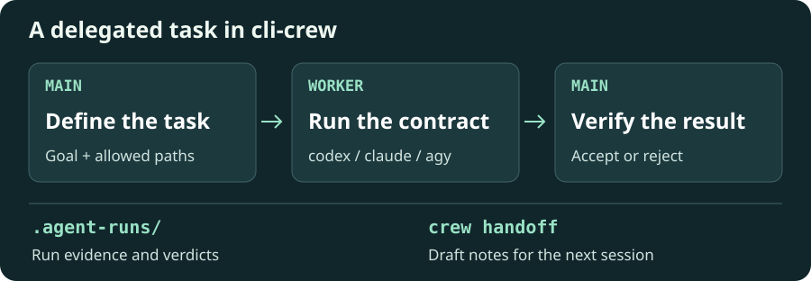

# cli-crew

[](LICENSE)


**English** · [한국어](README.ko.md)

**Delegate scoped tasks between AI coding CLIs, verify the results, and keep the evidence in your project.**

cli-crew lets the AI CLI you are already using (the *main* agent) hand bounded work to other non-interactive CLIs (*workers*): Codex, Claude Code, and Antigravity. A skill tells the main agent when delegation is worth it and how to verify the result. A dependency-free Python CLI, `crew`, does the mechanics: launching workers in safe modes, enforcing timeouts and approvals, checking file boundaries, and recording every run. The main agent always makes the final call.



[Features](#features) · [Installation](#installation) · [Quick start](#quick-start) · [Commands](#commands) · [Inspecting a run](#inspecting-a-run) · [Workers](#supported-workers) · [Safety](#safety-model-and-limitations) · [Compared](#how-cli-crew-differs-from-other-orchestrators) · [Update](#updating) · [Uninstall](#uninstalling) · [CLI reference](crew/README.md)

## Features

- **Goal-driven delegation.** You state the outcome. The main agent decides what to do itself, what to give its own subagents, what to hand to a worker, and when an independent review from a different model is worth the extra call.
- **Plans for multi-step goals.** The main agent writes a plan in which each step names its executor (itself, its own built-in subagents, or a crew worker), its dependencies, and how it will be verified. Runs are linked to steps, so progress survives a handoff.
- **Explicit task contracts.** Each delegated task is a Markdown contract with an objective, file paths for context, completion criteria, and, for edits, the exact paths the worker may change.
- **Verification before acceptance.** Every run is classified (`DONE`, `DONE_UNVERIFIED`, `PARTIAL`, `FAILED`, ...), checked for out-of-scope file changes and subagent use, and must be accepted or rejected by the main agent with a recorded reason.
- **Guardrails by default.** Read-only mode is the default, writes run one at a time, bypass flags are refused, credential-like environment variables are stripped from worker processes, and higher-cost or data-sharing runs require your approval.
- **Local, inspectable records.** Contracts, prompts, logs, results, and verdicts live under `.agent-runs/` in your project. `crew handoff` drafts a handoff note so another CLI can pick up the work.

## How it works

1. The main agent reads the project instructions and runs `crew detect` to see which workers are available.
2. For a separable task, it writes a contract (`crew contract new`) and launches it (`crew run`).
3. `crew` runs the worker in a safe mode and enforces the timeout. It classifies the outcome from the CLI's exit status and diagnostics and from the worker's result block.
4. `crew` compares a before/after snapshot of the project against the contract's permitted paths.
5. The main agent checks the worker's claims against the source, runs the tests itself, and records `crew accept` or `crew reject`.

## Installation

cli-crew is currently verified on **Windows 11** only.

**Requirements**

- Git, PowerShell 7 (`pwsh`), Python 3.12 or later, and [uv](https://docs.astral.sh/uv/)
- At least one worker CLI, installed and signed in: [Codex CLI](https://github.com/openai/codex), Claude Code, or Antigravity (`agy`)

**Install**

```powershell
git clone https://github.com/HBy-cloud/cli-crew.git
cd cli-crew
uv tool install ./crew
$env:Path = "$(uv tool dir --bin);$env:Path"
pwsh -File scripts/install-skill.ps1
crew --version
```

The installer registers the skill for Claude Code, Codex, and agy. To choose clients, pass `-Agents`, for example `pwsh -File scripts/install-skill.ps1 -Agents claude,codex`. Claude Code and Codex use directory junctions to the clone, and agy registers the skill directory in `~/.gemini/config/skills.json`, so keep the clone where it is. If a new terminal cannot find `crew`, run `uv tool update-shell` and reopen the terminal.

## Quick start

Open your **target project** in a new AI CLI session and describe the outcome you want:

> The CSV export drops the last row. Reproduce the bug, fix it, and add a regression test.

The main agent may fix a small bug directly. If an independent check helps, it can give a read-only worker one focused question, such as how the exporter handles a missing final newline, while it owns the fix and the regression test itself. The worker gets a contract with the question, the relevant paths, and the completion criteria. It does not get the whole conversation.

To invoke the skill explicitly, use `/cli-crew` in Claude Code or `$cli-crew` in Codex, or mention `cli-crew` in your prompt. Run `crew detect` in the project to see which workers are available.

**Project instructions.** When you ask for project setup, or invoke the skill by name with a request that permits edits, the main agent runs `crew init`. Existing root-level `AGENTS.md`, `CLAUDE.md`, or `GEMINI.md` files are used as they are. Otherwise a starter `AGENTS.md` is created and the main agent fills in the purpose, conventions, and test commands it can verify from the repository. If the main agent loads the skill on its own during other work, or the request is read-only, no instruction file is created. Instead, the final report notes once that the guide is missing and offers to set it up.

## Commands

The main agent normally runs these for you. You can also use them directly in PowerShell. Start with `crew --help`.

| Stage | Commands |
| --- | --- |
| Prepare the project | `crew init`, `crew detect` |
| Plan a multi-step goal | `crew plan new`, `crew plan check`, `crew plan show` |
| Choose a worker | `crew routing`, `crew compare` |
| Define the task | `crew contract new`, `crew contract check` |
| Run and monitor | `crew run`, `crew status`, `crew cancel` |
| Verify and decide | `crew result`, `crew check`, `crew accept`, `crew reject` |
| Hand off and clean up | `crew handoff`, `crew clean` |

See the [command reference](crew/README.md#command-reference) for full syntax and options.

## Inspecting a run

Suppose the main agent ran a review as task `T-01`. From the same project:

```powershell
crew status
crew result T-01
crew check T-01 --recheck
```

| Question | Where to look |
| --- | --- |
| What was the worker asked to do? | `.agent-runs/contracts/T-01.md`: scope, completion criteria, and permitted paths for write tasks. |
| What did it report? | `crew result T-01` shows the saved result. Add `--raw` for the full response. |
| Did it stay in scope? | `crew check T-01 --recheck` recomputes the boundary and subagent checks from saved evidence. |

Example: a worker can report success even when the final file-boundary check fails. `crew` then records `DONE_UNVERIFIED`, and the work cannot be accepted until the main agent records its own verification. The [regression tests](crew/tests/test_crew.py) cover this case. They also cover a read-only worker that modifies a file and a cancellation right after the worker starts.

## Supported workers

| Worker | Read and review | Edit files | Read access |
| --- | --- | --- | --- |
| Codex (`codex`) | Yes | Paths named in the contract | Any file the user can read |
| Claude Code (`claude`) | Yes | Paths named in the contract | Project and listed directories only |
| Antigravity (`agy`) | Yes | Refused before launch | Any file the user can read |

Adapters were verified with codex-cli 0.171.0, agy 1.5.13, and Claude Code 2.1.329. Re-check after upgrading a CLI. See [worker adapters](skill/cli-crew/references/adapters.md) for invocation details and known quirks.

## Safety model and limitations

- **Concurrency.** Up to three independent read tasks can run at once. A write task always runs alone.
- **No shell for workers.** Workers run in safe modes without shell access. The main agent runs commands, builds, and tests.
- **Boundary checks are detective, not isolating.** `crew` reports changes it can detect inside the project. It does not provide OS-level sandboxing, and writes outside the project are not detected. agy write tasks are refused because its write boundary cannot be enforced.
- **Data leaves your machine.** Workers use their own provider accounts, so delegated content goes to OpenAI, Anthropic, or Google. If project instructions mention sensitive data, `crew run` requires explicit approval. If they restrict external agents, the main agent asks before delegating.
- **Cost approval.** High reasoning effort, or models you list in `~/.crew/config.toml`, require approval before launch.
- **No automatic rollback.** `crew` reports violations but does not revert changes.

The full rules are in the [verification and approval protocol](skill/cli-crew/references/protocol.md).

## How cli-crew differs from other orchestrators

Several tools already let Claude Code call Codex, Gemini or Antigravity, from single-purpose "second opinion" skills to full multi-agent orchestrators such as [oh-my-claudecode](https://github.com/Yeachan-Heo/oh-my-claudecode). Those tools optimize for autonomy. cli-crew optimizes for control:

| | Autonomy-first orchestrators (e.g. oh-my-claudecode) | cli-crew |
| --- | --- | --- |
| Goal | Run teams of agents until the goal passes | Delegate only when it pays off; small work stays with the main agent |
| Orchestrator | Claude Code | Any of Claude Code, Codex or Antigravity |
| Worker permissions | Headless workers can run with auto-approve flags so they work unattended (their SECURITY.md lists Codex `--dangerously-bypass-approvals-and-sandbox` and Gemini `--approval-mode yolo`) | Workers run in safe modes only; bypass flags are refused |
| Boundaries between agents | Agents share the filesystem (listed as a known limitation in their SECURITY.md) | Each write task names its paths; visible changes outside them are reported (ignored files and excluded folders are not checked) |
| "Done" | Automated verify/fix loops until tests, build and lint pass | Anything short of a clean DONE needs the main agent's recorded verification before acceptance; the skill asks for it on every acceptance |

If you want maximum automation, an autonomy-first orchestrator is the better fit. Choose cli-crew if you want workers that cannot skip approvals, and a record of who changed what and how it was checked. The comparison reflects the oh-my-claudecode README and SECURITY.md as read on 2026-11-21.

## Handing off to another CLI

Before ending a session, run this from the project. Replace `codex` and `csv-export` with your agent and task name:

```powershell
crew handoff --agent codex --task csv-export --status "In progress" --lang en
```

This creates a dated Markdown draft under `handoffs/`, or under an existing `handoff/` directory. The draft includes the selected runs and the main agent's recorded verification. Complete the remaining work and next steps, then open the **same working copy** in the next CLI and ask it to read the latest handoff and compare it with the current Git state. Handoff is manual for now. Automatic main-agent switching is planned future work ([specification, T-06](docs/SPEC.md)).

## Updating

From your cli-crew clone, run:

```powershell
git pull --ff-only && uv tool install --reinstall ./crew && crew --version
```

When a version number is printed, the update is complete. Start a new AI CLI session to load the updated skill.

> **Tip:** In File Explorer, open the clone folder (it contains `crew` and `scripts`), type `pwsh` in the address bar, and press Enter to open PowerShell there.

## Uninstalling

From the original clone, unregister the skill first, then remove the command. The package is named `cli-crew`. The executable is named `crew`.

```powershell
pwsh -File scripts/install-skill.ps1 -Uninstall
uv tool uninstall cli-crew
```

To remove the skill from one client only, for example Codex:

```powershell
pwsh -File scripts/install-skill.ps1 -Uninstall -Agents codex
```

The script removes only junctions and entries that point to this clone. Other agy settings and backups are preserved. Your project files (`AGENTS.md`, `.agent-runs/`, handoffs) and the clone itself are left in place. After a full uninstall, `uv tool list` should no longer show `cli-crew`. If `crew` still runs, `Get-Command crew -All` shows which executable PowerShell finds.

## Project status

cli-crew is an early release (0.1.0). Windows installation, reinstallation, and removal are tested in disposable home directories. macOS and Linux have not been verified.

## Development

`crew` uses only the Python standard library. To run the test suite, which uses local fake workers and no provider calls:

```powershell
cd crew
py -3 -m unittest discover -s tests
```

GitHub Actions runs the same suite on Windows with Python 3.12 and 3.13 for every push to `main` and every pull request ([workflow](.github/workflows/test.yml)).

| Document | Contents |
| --- | --- |
| [crew/README.md](crew/README.md) | CLI command reference |
| [skill/cli-crew/SKILL.md](skill/cli-crew/SKILL.md) | Instructions the main agent follows |
| [docs/SPEC.en.md](docs/SPEC.en.md) | Architecture overview |
| [docs/SPEC.md](docs/SPEC.md) | Full specification (Korean) |

This project was built with AI assistance from Claude Code, Codex, and agy. They helped with specification drafting, implementation, cross-review, testing, and documentation.

## License

Released under the [MIT License](LICENSE).

cli-crew is an independent project and is not affiliated with, endorsed by, or sponsored by Anthropic, OpenAI, or Google. Claude, Claude Code, Codex, and Antigravity are trademarks of their respective owners and are used here only to identify the tools cli-crew works with.
